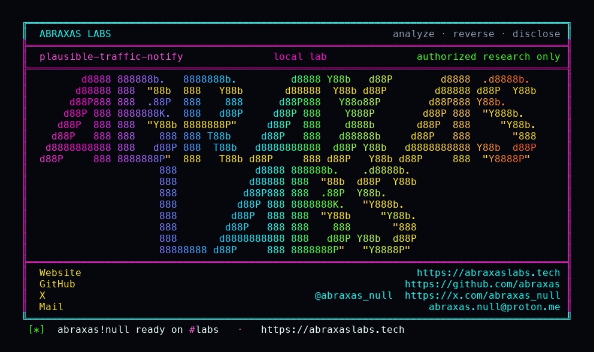

<p align="center">
  
</p>

<p align="center">
  <a href="https://abraxaslabs.tech"><strong>abraxaslabs.tech</strong></a>
  &nbsp;·&nbsp;
  <a href="https://github.com/abraxas">github.com/abraxas</a>
  &nbsp;·&nbsp;
  <a href="https://x.com/abraxas_null">@abraxas_null</a>
  &nbsp;·&nbsp;
  <a href="mailto:abraxas.null@proton.me">abraxas.null@proton.me</a>
  &nbsp;·&nbsp;
  <a href="https://github.com/abraxas/plausible-traffic-notify">plausible-traffic-notify</a>
</p>

# plausible-traffic-notify

**Plausible Analytics** community edition, GitHub master `d44e104ae3943a9240d5cb6b62e67dff0f069d3a` (2026-10-16) - Plausible Insights OÜ

**Class:** IDOR (mass-assignment). **Reach:** Remote (owner / admin / editor of a site the attacker already controls).

[`Plausible.Site.TrafficChangeNotification.changeset/2`](https://github.com/plausible/analytics/blob/d44e104ae3943a9240d5cb6b62e67dff0f069d3a/lib/plausible/site/traffic_change_notification.ex) still casts `:site_id`. [`SiteController.update_traffic_change_notification/2`](https://github.com/plausible/analytics/blob/d44e104ae3943a9240d5cb6b62e67dff0f069d3a/lib/plausible_web/controllers/site_controller.ex) loads the row by the authorized path domain, then `Repo.update!` of the client map. Route `PUT /sites/:domain/traffic-change-notification/:type` sits under `:browser` + CSRF + `AuthorizeSiteAccess` `[:owner, :admin, :editor, :super_admin]`. The HTML form only posts `threshold`. Phoenix still accepts extra keys.

whoareme Bug 02 patched Shield / Goal `site_id` the same way: bind `socket.assigns.site.id`, stop casting `:site_id`. This controller was not in that pass. Enable (`POST .../enable`) stamps `site_id: site.id` from assigns. Attacker enables on their own site, then PUTs `traffic_change_notification[site_id]=<victim_pk>`. Unique index `(site_id, type)`. Default install has no spike/drop row, so the update succeeds and the row now belongs to the victim. Table name is legacy `spike_notifications`.

**An editor of their own site re-parents the spike/drop notify row onto a victim site. Recipients stay the attacker mailbox. Oban mails attacker about victim traffic.**

| | |
|---|---|
| ID | no CVE yet |
| CWE | [CWE-915](https://cwe.mitre.org/data/definitions/915.html) / [CWE-639](https://cwe.mitre.org/data/definitions/639.html) |
| CVSS | **High: 7.1** `CVSS:3.1/AV:N/AC:L/PR:L/UI:N/S:U/C:H/I:L/A:L` |
| Product | [Plausible Analytics](https://github.com/plausible/analytics) |
| Affected | GitHub master `d44e104ae3943a9240d5cb6b62e67dff0f069d3a` (2026-10-16). Last CE tag v3.2.1 (`e4f5a87a5570bd61605217e7ceb376636db8eddb`, 2026-05-15) is five months behind. CE + EE (`lib/`, not `extra/lib`). |
| Auth | owner / admin / editor of a site they control. Viewer cannot. CSRF required (same-session IDOR). |
| License | [GNU Affero GPL v3.0](LICENSE) |
| Lab | `127.0.0.1:18183` (http) `18184` (postgres) `18185` (clickhouse http) only |

Leftover #2 of [Plausible Analytics leftovers](https://abraxaslabs.tech/research/plausible-analytics-leftovers). Same pin, other pack: [plausible-editor-invite](https://github.com/abraxas/plausible-editor-invite) (People HTML leaks transfer nanoid to editors). This pack is the Shield/Goal sibling that still casts `:site_id`.

## What an attacker can do

Owner, admin, or editor of any site they already control. Needs a session cookie and the CSRF token from that session. They do not need membership on the victim. They do not PUT the victim path domain (that 404s). They PUT their own domain with a foreign `site_id` integer PK.

Privilege table (exhaustive). Same bar as [Signal-Server Dropwizard admin](https://abraxaslabs.tech/research/signal-server-dropwizard-admin): method + path, what that call grants, recon vs integrity vs availability, lab-proven vs inferred, adjacent surface that stays closed.

| Axis | Method + path | Grants | Provenance |
|---|---|---|---|
| Integrity | `POST /sites/:attacker_domain/traffic-change-notification/:type/enable` then `PUT /sites/:attacker_domain/traffic-change-notification/:type` with `traffic_change_notification[site_id]=<victim_pk>` | Re-parent attacker `spike_notifications` row onto `victim.sites.id`. Recipients stay the attacker address. Owns the unique `(site_id, type)` slot. Threshold is attacker-chosen (lab used 1). | **Lab-proven.** Row 1 moved `site_id` 2 → 1, recipients `{attacker@lab.invalid}` |
| Recon | Oban `TrafficChangeNotifier` email to `notification.recipients` | Subject `Traffic spike on <victim.domain>`. Body: current visitor count, top 3 sources, top 3 pages. First send is immediate (`last_sent` nil). Repeat at most every 12 hours. Threshold 1 yields a mail whenever the victim has any current visitor. Dashboard HTML / installation links in the mail are omitted unless the recipient is a team/guest member (attacker is not). | **Inferred** from notifier source. Mail not captured in lab (`MAILER_ADAPTER=Bamboo.LocalAdapter`) |
| Availability | victim `POST .../enable` of the same type | Unique `(site_id, type)` rejects. Victim cannot turn the feature on until the planted row is gone. | Source (`unique_constraint`) |
| Availability | victim `disable` (`delete_all` by `site_id`) | Victim can clear the planted row if they notice the extra recipient. | Source (`disable_traffic_change_notification`) |

**Stays closed on this pin**

| Axis | Method + path | Why it is closed |
|---|---|---|
| Integrity | `PUT /sites/:victim_domain/traffic-change-notification/:type` | Path domain is `AuthorizeSiteAccess`. Attacker is not a member. **Lab-proven 404.** `attacker-not-member-of-victim=1` |
| Integrity | Shield / Goal / funnel / segment / shared-link write | whoareme Bug 02 patched those `cast :site_id` handlers. They bind assigns. |
| Recon | ClickHouse dump, Stats API, dashboard HTML | No membership, no shared link. Notifier mail omits dashboard links for a non-member. |
| Integrity | tracker ingest | Already unauth `POST /api/event` with a client-chosen domain. Not this leftover. |
| Integrity | `Repo.update!` when victim already has that type | 500 on unique `(site_id, type)`. Default install has no row, so first plant works. |
| Integrity | viewer of attacker site | `AuthorizeSiteAccess` is owner/admin/editor. Viewer cannot. |
| Integrity | OS shell, super-admin LiveView | Closed. No shell. |

I am not claiming ClickHouse dump, a reverse shell, or dashboard login as the victim. The dump is traffic recon in mail the attacker already receives: domain, live visitors, top sources, top pages. `site_id` is the integer PK (enumerable; whoareme used `site_id=1`). Dashboard `data-*` does not emit it.

## How I found it

whoareme Bug 02 taught Shield and Goal to stop casting `:site_id`. I grepped remaining `cast(.*:site_id` under `lib/`. Traffic-change notification still had it. Enable stamps assigns. Update takes the client map. That is the leftover.

`run.sh` clones the pin if `plausible-lab:d44e104ae3943a` is missing, brings compose up with `DISABLE_REGISTRATION=false` so two independent teams can register, seeds `victim.lab` (id 1 team 1) and `attacker.lab` (id 2 team 2), enables spike notify on attacker, then PUTs `site_id=1`.

Wrong turns already recorded: `SECRET_KEY_BASE` shorter than 64 bytes (`Plug.Session.COOKIE` refuses it); PUT on the victim path domain (404, that is the closed adjacent); treating enable as the bug (enable is correctly assigned). Theatre.

## Lab

```bash
python3 plausible-traffic-notify-Abraxas-Labs.py
```

or

```bash
cd lab
./run.sh
```

Target **only** `http://127.0.0.1:18183`. Image `plausible-lab:d44e104ae3943a` (`MIX_ENV=ce`, pin `d44e104ae3943a9240d5cb6b62e67dff0f069d3a`). Docker required. First run clones https://github.com/plausible/analytics at that SHA and builds the image. The launcher `chdir`s into `lab/` and execs `run.sh`.

```text
IOC victim.lab id=1 team=1 attacker.lab id=2 team=2
IOC attacker-not-member-of-victim=1
IOC put-victim-path http=404
IOC spike_notifications row 1 site_id 2 -> 1 recipients={attacker@lab.invalid}
SUCCESS plausible-traffic-notify PLAUSIBLE-H03-TRAFFIC-NOTIFY-SITEID-WITNESS
```

Witness string: `PLAUSIBLE-H03-TRAFFIC-NOTIFY-SITEID-WITNESS`. Oracle is the `spike_notifications.site_id` move. Notifier mail recon stays inferred.

## The fix

Stop casting `:site_id`. Bind `site.id` from `conn.assigns` the way Shield and Goal already do after whoareme Bug 02.

```elixir
def changeset(schema, attrs) do
  schema
  |> cast(attrs, [:recipients, :threshold, :type])
  |> validate_required([:recipients, :threshold, :type])
  |> validate_number(:threshold, greater_than_or_equal_to: 1)
  |> unique_constraint([:site_id, :type])
end
```

Keep `site_id` on insert from assigns in `enable`. Do not take it from the PUT body.

Re-run the [loopback client](https://github.com/abraxas/plausible-traffic-notify/blob/main/plausible-traffic-notify-Abraxas-Labs.py) against a patched build: after PUT with a foreign `site_id`, the row must stay on attacker `sites.id`. Victim path PUT must stay 404.

Until then, do not treat "I patched Shield and Goal" as "every changeset that belongs_to Site stopped casting `:site_id`."

## References

- [github.com/plausible/analytics](https://github.com/plausible/analytics) master [`d44e104ae3943a9240d5cb6b62e67dff0f069d3a`](https://github.com/plausible/analytics/commit/d44e104ae3943a9240d5cb6b62e67dff0f069d3a)
- [`TrafficChangeNotification.changeset/2`](https://github.com/plausible/analytics/blob/d44e104ae3943a9240d5cb6b62e67dff0f069d3a/lib/plausible/site/traffic_change_notification.ex) (`traffic_change_notification.ex:19-25`)
- [`SiteController.update_traffic_change_notification/2`](https://github.com/plausible/analytics/blob/d44e104ae3943a9240d5cb6b62e67dff0f069d3a/lib/plausible_web/controllers/site_controller.ex) (`site_controller.ex:489-504`)
- Nearby patched (not this lookup): whoareme 2026-08-25 Bug 02 Shield / Goal `site_id` mass-assignment
- Same pin: [plausible-editor-invite](https://github.com/abraxas/plausible-editor-invite)
- Series hub: [Plausible Analytics leftovers](https://abraxaslabs.tech/research/plausible-analytics-leftovers)
- [CWE-915](https://cwe.mitre.org/data/definitions/915.html) · [CWE-639](https://cwe.mitre.org/data/definitions/639.html)

## License

GNU Affero GPL v3.0. See [LICENSE](LICENSE). Loopback lab only. No warranty.
